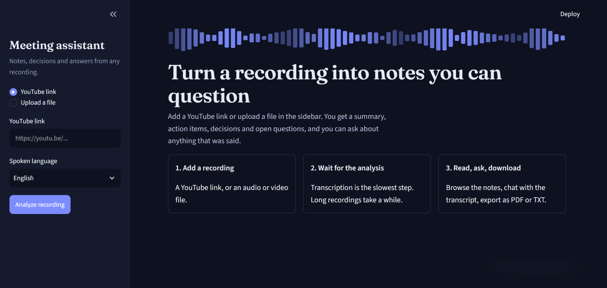
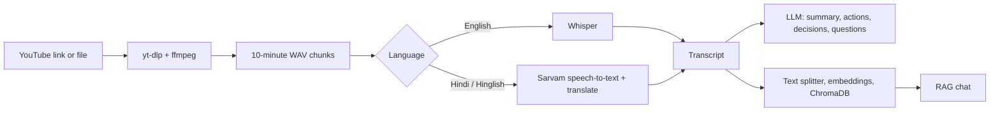

# AI Meeting Assistant

Turn a meeting recording into a summary, action items, key decisions and open questions, then chat with the transcript. Built with Python, LangChain (LCEL), Whisper, ChromaDB and Streamlit.

<!-- Add a screenshot of the app:  -->

## Features

- **Two input types:** a YouTube link or an uploaded audio/video file
- **Transcription:** Whisper for English (Groq-hosted by default, local Whisper as a fallback), and Sarvam AI for Hindi/Hinglish with translation to English
- **Meeting notes:** summary, action items (with owner and deadline), key decisions and open questions, written by a Groq-hosted LLM through LangChain LCEL
- **Chat with the meeting:** a RAG pipeline using HuggingFace embeddings and ChromaDB, so answers come from the transcript
- **Transcript search** and **export** to PDF or TXT
- **Streamlit interface** with a dark theme

## How it works



## Tech stack

| Area | Tools |
| --- | --- |
| Interface | Streamlit |
| Audio | yt-dlp, ffmpeg, pydub |
| Speech to text | Whisper (Groq API or local), Sarvam AI |
| LLM | Groq via `langchain-groq` |
| RAG | LangChain, sentence-transformers (`all-MiniLM-L6-v2`), ChromaDB |
| Export | fpdf2 |

## Project structure

```
.
├── app.py                  # Streamlit interface
├── main.py                 # Command-line version
├── core/
│   ├── llm.py              # Shared LLM setup
│   ├── transcriber.py      # Whisper and Sarvam transcription
│   ├── summarizer.py       # Title and summary
│   ├── extractor.py        # Action items, decisions, open questions
│   ├── vector_store.py     # Embeddings and ChromaDB
│   └── rag_engine.py       # RAG chain
├── utils/
│   └── audio_processor.py  # Download, convert and chunk audio
├── .streamlit/config.toml  # Theme and upload limit
├── requirements.txt
└── .env.example
```

## Getting started

### Prerequisites

- Python 3.10 or newer
- **ffmpeg** installed on your system:
  - Windows: `winget install Gyan.FFmpeg` (then restart your terminal)
  - macOS: `brew install ffmpeg`
  - Linux: `sudo apt install ffmpeg`
- A free [Groq API key](https://console.groq.com). A Sarvam AI key is only needed for Hindi/Hinglish.

### Installation

```bash
git clone https://github.com/<your-username>/<your-repo>.git
cd <your-repo>

python -m venv .venv
# Windows (PowerShell): .venv\Scripts\Activate.ps1
# macOS / Linux:        source .venv/bin/activate

pip install -r requirements.txt
```

### Configuration

Copy `.env.example` to `.env` and add your keys:

```
GROQ_API_KEY=your_groq_key
SARVAM_API_KEY=your_sarvam_key
```

Optional settings:

| Variable | Default | Purpose |
| --- | --- | --- |
| `GROQ_MODEL` | `openai/gpt-oss-120b` | LLM used for notes and chat. Groq retires models over time, so check [console.groq.com/docs/models](https://console.groq.com/docs/models) if you get a "model not found" error |
| `WHISPER_BACKEND` | `groq` | Set to `local` to always use local Whisper |
| `WHISPER_MODEL` | `small` | Local Whisper size (`tiny`, `base`, `small`...) |

### Run

```bash
streamlit run app.py
```

Or use the command-line version:

```bash
python main.py
```

## Usage

1. Paste a YouTube link or upload a file in the sidebar.
2. Choose the spoken language and press **Analyze recording**.
3. Read the notes, search the transcript, or open **Ask the meeting** to question it.
4. Download the results as PDF or TXT.

## Notes and limitations

- **Speed:** local Whisper on a CPU is slow. The Groq-hosted Whisper is much faster. The Hindi/Hinglish path sends 25-second pieces to Sarvam one at a time, so it is slower.
- **Free-tier limits:** Groq limits requests, tokens and audio per minute and per day. Very long recordings can hit them.
- **YouTube on servers:** YouTube often blocks downloads from cloud IP addresses, so links that work on your computer may fail once deployed. File upload is the reliable option there.
- **PDF export** uses a basic font, so non-Latin characters appear as `?`. The TXT export keeps every character.

## Deploying on Streamlit Community Cloud

1. Push the repo to GitHub, with `requirements.txt` in the root.
2. Add a `packages.txt` file containing the single line `ffmpeg`.
3. Create the app at [share.streamlit.io](https://share.streamlit.io) and add your keys under **Secrets**, for example `GROQ_API_KEY = "..."`.
4. Never commit your `.env` file.

Memory on the free tier is limited, so use the Groq-hosted Whisper (`WHISPER_BACKEND=groq`) instead of loading a local model.

## Troubleshooting

| Problem | Fix |
| --- | --- |
| `ffprobe and ffmpeg not found` | Install ffmpeg and restart your terminal or editor |
| `model_not_found` from Groq | Set `GROQ_MODEL` to a model listed in the Groq docs |
| `python-dotenv could not parse statement` | A line in `.env` is not in `NAME=value` form; comments need a `#` |
| Rate limit (429) errors | Wait a minute, use a smaller model, or lower the concurrency |

## License

Add a license of your choice, for example MIT.
